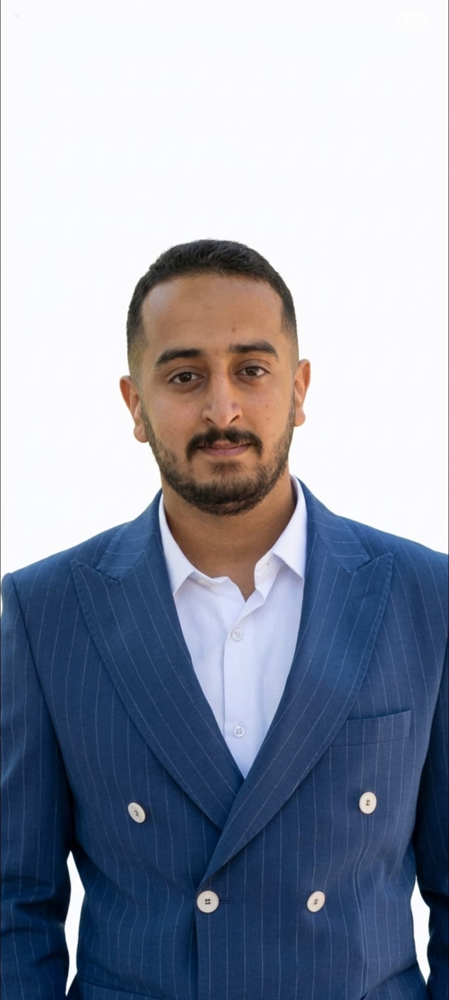

<div align="center">
<a href="https://github.com/AZZAM-ALNAMER"></a>
</div>

<div align="center">
<h1>Azzam Hesham Al-Sarari — AI Engineer</h1>
<p>Personal portfolio showcasing work across LLMs, agentic AI, and Backend.fastapi</p>
</div>

# Tech Stack

- [NextJS][nextjs] - UI framework
- [Vercel][vercel] - Hosting and Deployment
- [Sanity.io][sanity]: Headless CMS and Content Lake
- [TailwindCSS][tailwind] / CSS - Styling and UI
- [Umami][umami]: Analytics
- [React Refractor][reactrefractor]: Syntax Highlighting

## Project Overview

This portfolio highlights AI engineering projects, experience, skills, and education. The CV and project gallery images are served locally from `public/`.

## Run Project Locally

Follow this guide to get this site running locally:

### Install and Run

```bash
npm install
npm run dev
```

The portfolio works without API credentials. Set `GEMINI_API_KEY` to enable Gemini-backed responses in the chatbot.

## Build

```bash
npm run build
```

## License & Usage

This project is licensed under the MIT License - see the [LICENSE](LICENSE) file for details.

Portfolio content (c) Azzam Hesham Al-Sarari. The base project retains its MIT license; see [LICENSE](LICENSE).

<!-- Link Refs -->

[nextjs]: https://nextjs.org
[vercel]: https://vercel.com
[sanity]: https://sanity.io
[tailwind]: https://tailwindcss.com
[umami]: https://umami.is
[reactrefractor]: https://github.com/rexxars/react-refractor
